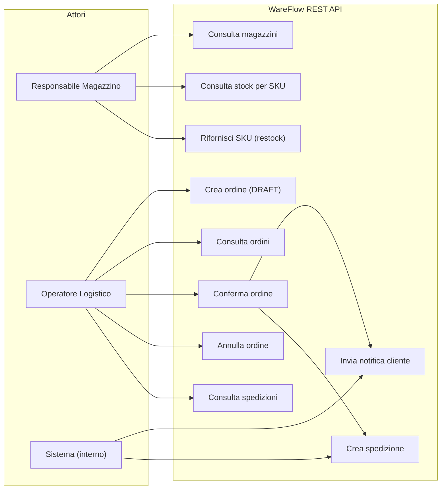
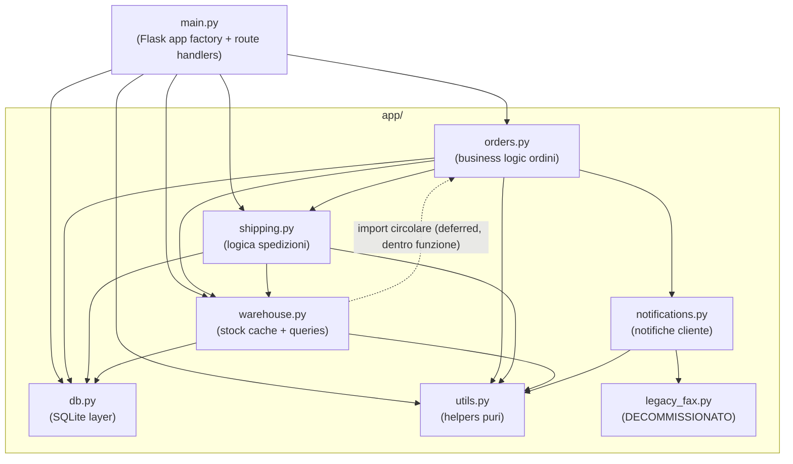
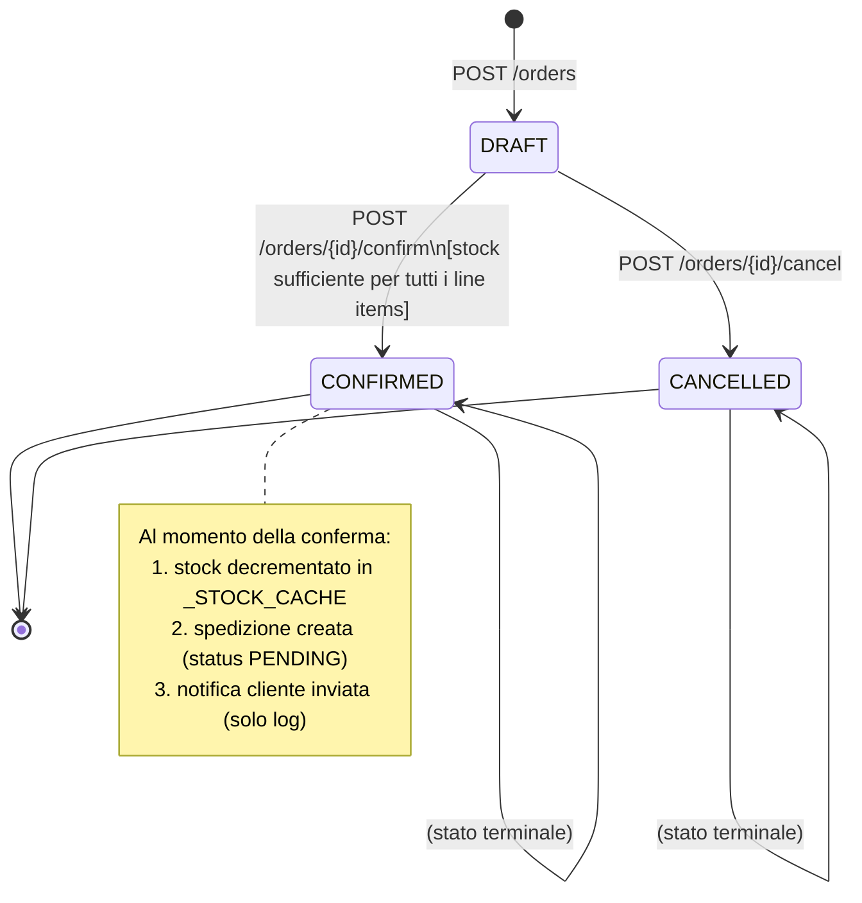
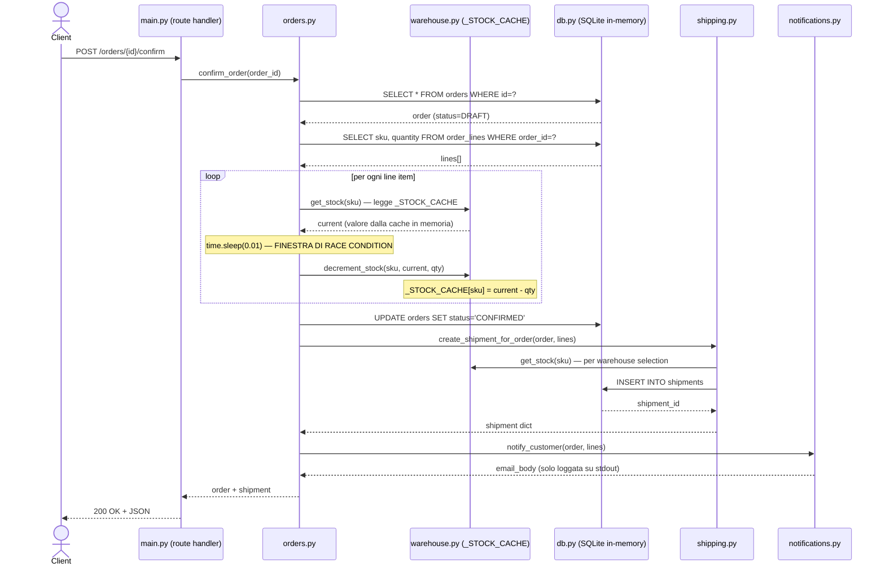
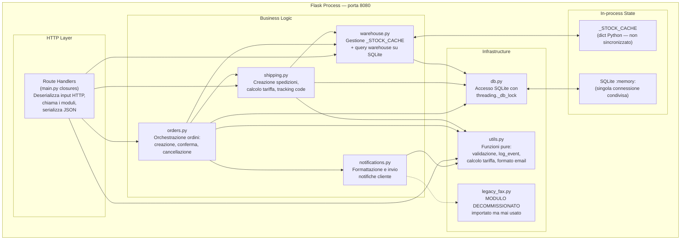
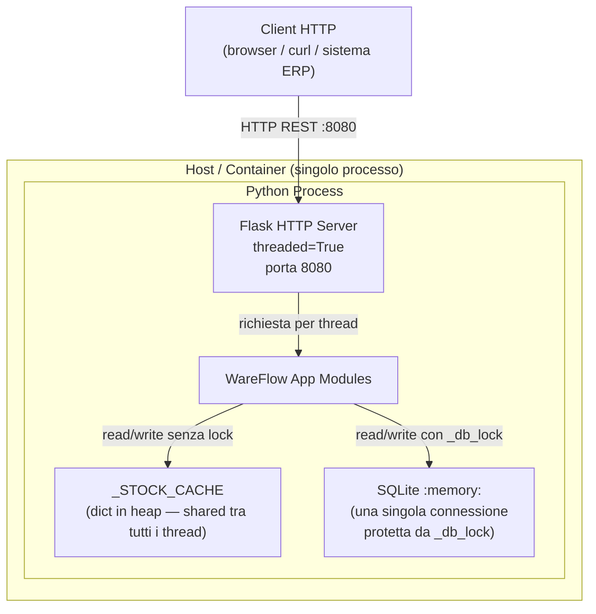

# WareFlow — Architettura del Sistema

> Documento prodotto da analisi diretta del codice sorgente.  
> Non si basa sul README esistente, ma sulla struttura reale verificata modulo per modulo.

---

## 1. Vista dei Requisiti — Use Case Diagram

Gli attori principali e le operazioni che il sistema espone.



---

## 2. Vista Logica — Package Diagram

Mappa dei moduli Python e le loro dipendenze dichiarate (import) al momento del caricamento del processo.



> **Nota sull'import circolare:** `warehouse.py` importa `orders.py` all'interno del corpo della funzione `get_reserved_quantity()` per evitare un `ImportError` al caricamento. L'import deferred "funziona" ma crea una dipendenza nascosta non visibile in cima al file.

---

## 3. Vista Logica — Data Model Diagram

Schema delle entità persistite in SQLite e relazioni tra di esse.

```mermaid
**erDiagram**
    warehouses {
        int id PK
        text name
        text city
    }
    stock {
        text sku PK
        int warehouse_id PK
        text name
        int quantity
    }
    orders {
        int id PK
        text customer_name
        text status
        text created_at
    }
    order_lines {
        int id PK
        int order_id FK
        text sku
        int quantity
    }
    shipments {
        int id PK
        int order_id FK
        int warehouse_id FK
        text tracking_code
        text status
    }

    warehouses ||--o{ stock : "ospita"
    orders ||--o{ order_lines : "contiene"
    orders ||--o| shipments : "genera"
    warehouses ||--o{ shipments : "origine"
```

**Valori possibili di `orders.status`:** `DRAFT` → `CONFIRMED` oppure `CANCELLED`  
**Valori possibili di `shipments.status`:** `PENDING` (unico valore scritto dal codice attuale)

---

## 4. Vista dei Processi — State Machine: ciclo di vita di un ordine



---

## 5. Vista dei Processi — Sequence Diagram: `POST /orders/{id}/confirm`

Questo è il flusso critico che coinvolge tutti i moduli. È anche il percorso in cui si manifesta il bug di concorrenza.



---

## 6. Vista dei Processi — Activity Diagram: `POST /stock/{sku}/restock`

```mermaid
flowchart TD
    A([Client: POST /stock/sku/restock]) --> B[Leggi quantity dal body JSON]
    B --> C[warehouse.restock(sku, quantity)]
    C --> D["_STOCK_CACHE[sku] += quantity\n(nessuna scrittura su SQLite)"]
    D --> E[warehouse.get_stock(sku)]
    E --> F([Risposta: sku + quantity aggiornata])
```

> **Nota:** `restock` aggiorna **solo** `_STOCK_CACHE` — non scrive nulla in SQLite. Dopo un riavvio del processo lo stock aggiunto a runtime va perso.

---

## 7. Vista dei Componenti — Component Diagram

Responsabilità e confini di ciascun componente applicativo.



---

## 8. Vista Fisica — Deployment Diagram



> **Nota critica:** L'app viene avviata con `app.run(threaded=True)`. Ogni richiesta HTTP viene gestita in un thread separato. L'unico stato condiviso tra i thread — `_STOCK_CACHE` — **non è protetto da alcun lock**. Il `_db_lock` in `db.py` protegge solo SQLite, non la cache.

---

## 9. Analisi dei problemi architetturali identificati

### 🔴 BUG CRITICO — Race condition su `_STOCK_CACHE`

**Causa dei conteggi di stock sbagliati segnalati durante i picchi di attività.**

**Moduli coinvolti:**
- [`warehouse.py`](../challenge-starter/app/warehouse.py) — funzione `decrement_stock()` (riga 32) e `get_stock()` (riga 28)
- [`orders.py`](../challenge-starter/app/orders.py) — funzione `confirm_order()` (riga 52)

**Meccanismo del bug — lost update:**

```
Thread A (ordine #1, WIDGET-1 x100):   current = get_stock("WIDGET-1")  → 1000
                                         time.sleep(0.01)  ← Thread B parte qui
Thread B (ordine #2, WIDGET-1 x200):   current = get_stock("WIDGET-1")  → 1000 (stesso valore!)
                                         time.sleep(0.01)
Thread A:  decrement_stock("WIDGET-1", 1000, 100) → _STOCK_CACHE = 900
Thread B:  decrement_stock("WIDGET-1", 1000, 200) → _STOCK_CACHE = 800  ← SBAGLIATO: doveva essere 700
```

Risultato: 300 unità sparite dalla cache senza che siano mai state effettivamente prelevate — oppure, equivalentemente, la stessa unità è stata venduta a due ordini distinti.

**Radice del problema:** `decrement_stock()` riceve `quantity_before` come parametro dal chiamante (il valore letto **prima** della `sleep`), invece di rileggere la cache al momento della scrittura. La firma stessa della funzione rende strutturale la perdita dell'aggiornamento.

---

### 🟡 PROBLEMA — Cache in-memory scollegata dal database in scrittura

- `restock()` aggiorna `_STOCK_CACHE` ma **non scrive mai in `stock.quantity` su SQLite**.
- `initialize_stock_cache()` legge da SQLite **una sola volta all'avvio**. Dopo un riavvio del processo, tutti i restock eseguiti a runtime vengono persi.
- `GET /stock/<sku>` legge esclusivamente dalla cache: non riflette mai la realtà del DB dopo il primo restock in-process.

---

### 🟡 PROBLEMA — Import circolare deferred (dipendenza nascosta)

- `warehouse.py` importa `orders.py` **dentro** il corpo di `get_reserved_quantity()` per evitare un `ImportError` a livello di modulo.
- Questo crea una dipendenza bidirezionale `orders ↔ warehouse` non visibile staticamente analizzando gli import in cima al file.
- `get_reserved_quantity()` non è chiamata da nessun percorso HTTP attuale: è codice sostanzialmente morto che porta con sé una complessità strutturale non necessaria.

---

### 🟡 PROBLEMA — Modulo `legacy_fax.py` importato ma mai usato

- `notifications.py` importa `legacy_fax` con il commento `# noqa: F401 - unused`.
- Il modulo contiene `FAX_GATEWAY_HOST = "10.0.0.17"` (server dismesso) e una funzione `send_fax_notification()` che solleva `NotImplementedError`.
- Non causa errori a runtime, ma inganna chi legge il codice e contribuisce alla dipendenza di `notifications.py` da un modulo morto.

---

### 🟠 PROBLEMA — Stato completamente volatile (SQLite in-memory)

- Il database SQLite è `:memory:`. **Ogni riavvio del processo azzera completamente lo stato**: ordini, stock, spedizioni.
- Non esiste persistenza su disco, backup, o strategia di migrazione dello schema.

---

### ℹ️ NOTA — `_db_lock` protegge SQLite ma non la cache

`db.py` usa correttamente un `threading.Lock()` per serializzare le chiamate a SQLite e prevenire `InterfaceError`. Questo è necessario e funziona, ma **non ha alcun effetto sui bug di stock**, perché questi avvengono interamente sulla cache in memoria (`_STOCK_CACHE`), completamente fuori dal lock.

---

## 10. Riepilogo dipendenze tra moduli

| Modulo | Dipende da |
|---|---|
| `main.py` | `db`, `orders`, `shipping`, `warehouse`, `utils` |
| `orders.py` | `db`, `shipping`, `warehouse`, `notifications`, `utils` |
| `shipping.py` | `db`, `warehouse`, `utils` |
| `warehouse.py` | `db`, `utils` + `orders` *(deferred, circolare)* |
| `notifications.py` | `utils`, `legacy_fax` *(import inutilizzato)* |
| `utils.py` | *(nessuna dipendenza interna)* |
| `legacy_fax.py` | *(nessuna dipendenza interna)* |
| `db.py` | *(nessuna dipendenza interna)* |

---

## 11. Mappa degli endpoint REST

| Metodo | Path | Modulo | Funzione |
|---|---|---|---|
| `GET` | `/warehouses` | `warehouse` | `list_warehouses()` |
| `GET` | `/stock/<sku>` | `warehouse` | `get_stock(sku)` |
| `POST` | `/stock/<sku>/restock` | `warehouse` | `restock(sku, quantity)` |
| `GET` | `/orders` | `orders` | `list_orders()` |
| `POST` | `/orders` | `orders` | `create_order(customer_name, lines)` |
| `GET` | `/orders/<id>` | `orders` | `get_order(order_id)` |
| `POST` | `/orders/<id>/confirm` | `orders` | `confirm_order(order_id)` |
| `POST` | `/orders/<id>/cancel` | `orders` | `cancel_order(order_id)` |
| `GET` | `/shipments` | `shipping` | `list_shipments()` |
