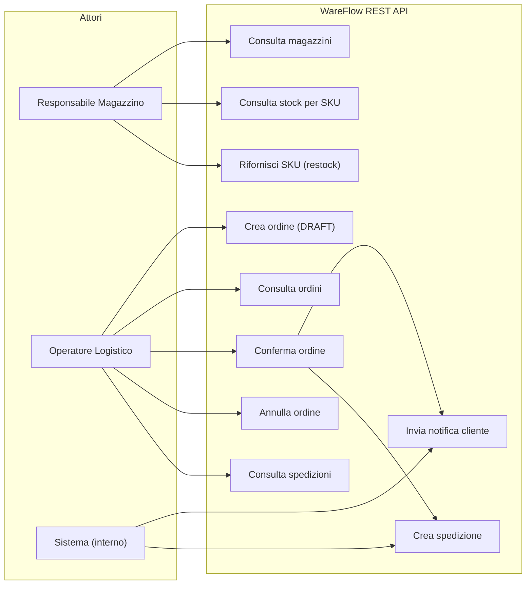
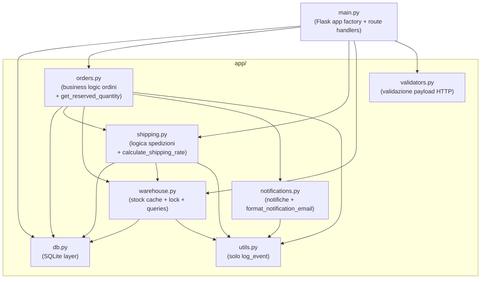
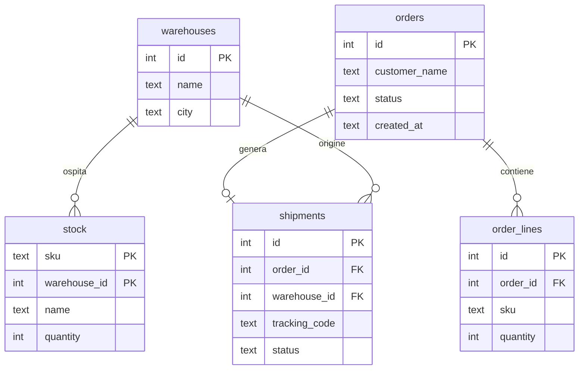
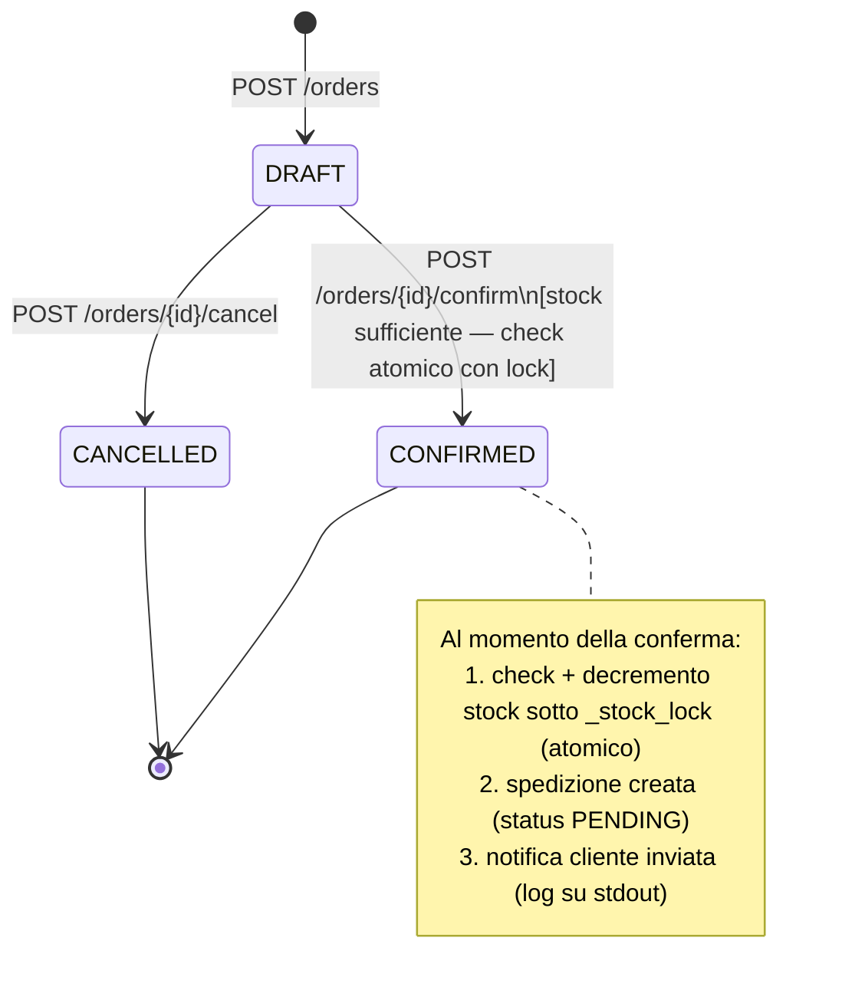
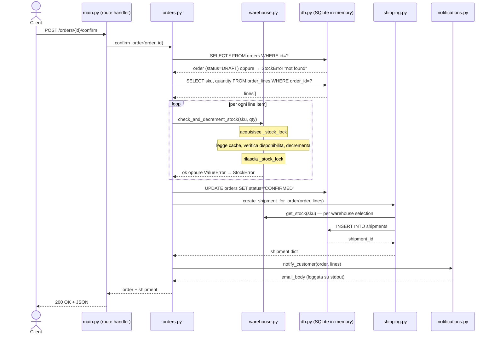
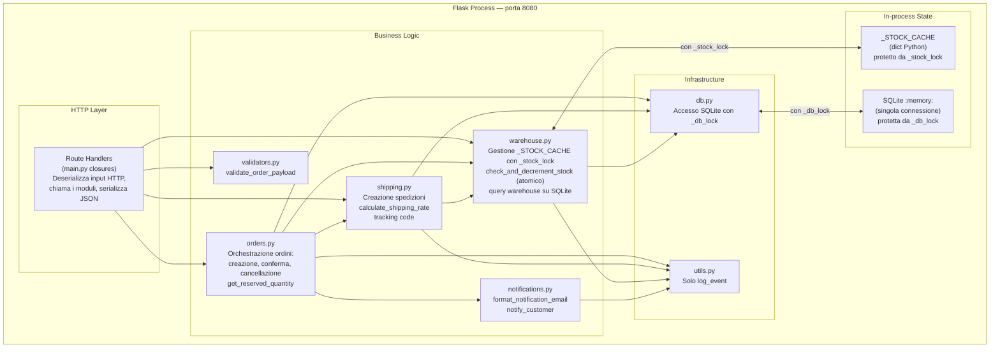
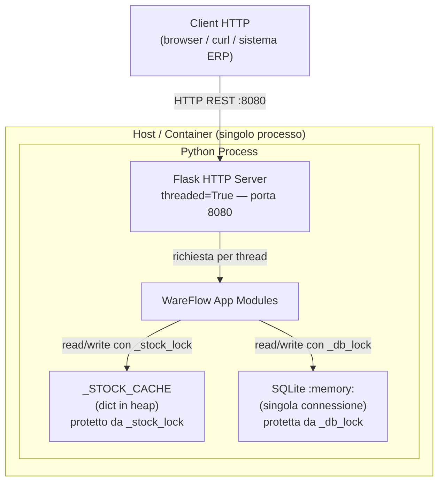

# WareFlow — Architettura del Sistema (post-refactoring)

> Documento prodotto da analisi diretta del codice sorgente rifattorizzato (M3 + fix concorrenza M4).  
> Descrive la struttura reale dell'applicazione nello stato attuale — non quella originale.

---

## 1. Vista dei Requisiti — Use Case Diagram

Gli attori principali e le operazioni che il sistema espone. Invariati rispetto alla versione originale: il refactoring non ha cambiato il comportamento esterno.



---

## 2. Vista Logica — Package Diagram

Mappa dei moduli Python e le dipendenze reali dopo il refactoring. Nessun ciclo, nessun modulo decommissionato, responsabilità separate.



> **Nessun ciclo.** La dipendenza circolare `warehouse ↔ orders` è stata eliminata spostando `get_reserved_quantity()` in `orders.py`. Il modulo `legacy_fax.py` è stato rimosso insieme a tutti i suoi riferimenti.

---

## 3. Vista Logica — Data Model Diagram

Schema delle entità persistite in SQLite. Invariato rispetto all'originale: il refactoring non ha toccato il database.



**Valori possibili di `orders.status`:** `DRAFT` → `CONFIRMED` oppure `CANCELLED`  
**Valori possibili di `shipments.status`:** `PENDING` (unico valore scritto dal codice)

---

## 4. Vista dei Processi — State Machine: ciclo di vita di un ordine



---

## 5. Vista dei Processi — Sequence Diagram: `POST /orders/{id}/confirm`

Il flusso critico dopo il fix della concorrenza. Il check e il decremento dello stock avvengono ora come operazione atomica all'interno di `_stock_lock`.



---

## 6. Vista dei Processi — Activity Diagram: `POST /stock/{sku}/restock`

```mermaid
flowchart TD
    A([Client: POST /stock/sku/restock]) --> B[Leggi quantity dal body JSON]
    B --> C[warehouse.restock(sku, quantity)]
    C --> D["acquisisce _stock_lock\n_STOCK_CACHE[sku] += quantity\nrilascia _stock_lock"]
    D --> E[warehouse.get_stock(sku)]
    E --> F([Risposta: sku + quantity aggiornata])
```

> **Nota:** `restock` aggiorna **solo** `_STOCK_CACHE` — non scrive su SQLite. Lo stock aggiunto a runtime non sopravvive a un riavvio del processo. L'operazione è ora thread-safe grazie a `_stock_lock`.

---

## 7. Vista dei Componenti — Component Diagram

Responsabilità e confini di ciascun componente dopo il refactoring.



---

## 8. Vista Fisica — Deployment Diagram



> L'app gira con `threaded=True`: ogni richiesta HTTP viene gestita in un thread separato. Dopo il refactoring **entrambi** gli stati condivisi sono protetti: `_STOCK_CACHE` da `_stock_lock` in `warehouse.py`, SQLite da `_db_lock` in `db.py`.

---

## 9. Riepilogo dipendenze tra moduli

| Modulo | Dipende da |
|---|---|
| `main.py` | `db`, `orders`, `shipping`, `warehouse`, `validators` |
| `orders.py` | `db`, `shipping`, `warehouse`, `notifications`, `utils` |
| `shipping.py` | `db`, `warehouse`, `utils` |
| `warehouse.py` | `db`, `utils` |
| `notifications.py` | `utils` |
| `validators.py` | *(nessuna dipendenza interna)* |
| `utils.py` | *(nessuna dipendenza interna)* |
| `db.py` | *(nessuna dipendenza interna)* |

**Nessun ciclo.** Verificato con `detect_cycles.py` → `no cycles`.

---

## 10. Mappa degli endpoint REST

| Metodo | Path | Modulo | Funzione |
|---|---|---|---|
| `GET` | `/warehouses` | `warehouse` | `list_warehouses()` |
| `GET` | `/stock/<sku>` | `warehouse` | `get_stock(sku)` |
| `POST` | `/stock/<sku>/restock` | `warehouse` | `restock(sku, quantity)` |
| `GET` | `/orders` | `orders` | `list_orders()` |
| `POST` | `/orders` | `orders` | `create_order(customer_name, lines)` |
| `GET` | `/orders/<id>` | `orders` | `get_order(order_id)` |
| `POST` | `/orders/<id>/confirm` | `orders` | `confirm_order(order_id)` |
| `POST` | `/orders/<id>/cancel` | `orders` | `cancel_order(order_id)` |
| `GET` | `/shipments` | `shipping` | `list_shipments()` |

---

## 11. Problemi risolti rispetto alla versione originale

| Problema originale | Stato |
|---|---|
| Race condition su `_STOCK_CACHE` (lost update tra thread) | ✅ Risolto — `check_and_decrement_stock()` è atomico sotto `_stock_lock` |
| Import circolare `warehouse ↔ orders` (deferred, nascosto) | ✅ Risolto — `get_reserved_quantity()` spostata in `orders.py` |
| `utils.py` con responsabilità miste (4 funzioni non correlate) | ✅ Risolto — split in `validators.py`, `notifications.py`, `shipping.py`, `utils.py` |
| `legacy_fax.py` decommissionato ma ancora importato | ✅ Risolto — modulo eliminato, zero riferimenti residui |
| `confirm_order` restituiva `None` per ordine inesistente | ✅ Risolto — ora solleva `StockError` coerentemente con gli altri casi |

### ⚠️ Limitazioni strutturali ancora presenti

| Limitazione | Nota |
|---|---|
| Stato completamente volatile (SQLite `:memory:`) | Ogni riavvio azzera ordini, stock e spedizioni. Non affrontato: fuori scope del refactoring |
| `restock()` non persiste su SQLite | Lo stock aggiunto a runtime non sopravvive al riavvio |
| `initialize_stock_cache()` deve essere chiamata prima di `create_shipment_for_order()` | Dipendenza di ordine di inizializzazione non dichiarata esplicitamente |
