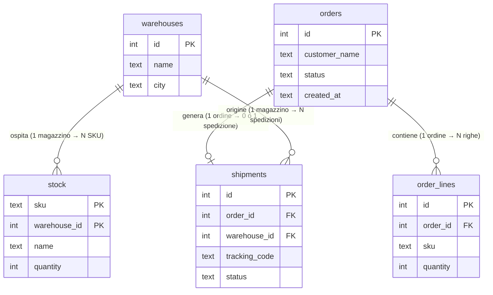
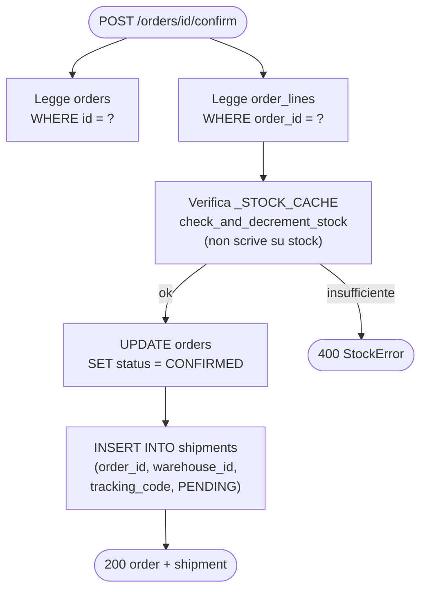
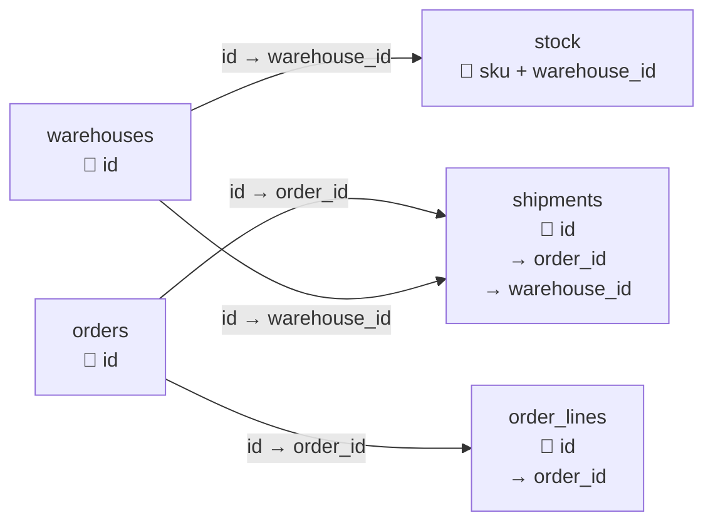

# WareFlow — Struttura del Database

Il database di WareFlow è un **SQLite in-memory**: viene creato al lancio del processo
e azzerato ad ogni riavvio. Contiene 5 tabelle che modellano magazzini, articoli,
ordini e spedizioni.

---

## Le 5 tabelle

### `warehouses` — Magazzini fisici

Contiene i magazzini registrati nel sistema. È una tabella di configurazione: non
esiste un endpoint API per modificarla.

| Colonna | Tipo | Note |
|---|---|---|
| `id` | INTEGER | Chiave primaria, autoincrementale |
| `name` | TEXT | Nome del magazzino |
| `city` | TEXT | Città dove si trova |

**Dati iniziali (seed):**
| id | name | city |
|---|---|---|
| 1 | Milano Nord | Milano |
| 2 | Bologna Est | Bologna |
| 3 | Torino Sud | Torino |

---

### `stock` — Disponibilità articoli per magazzino

Ogni riga indica quante unità di un certo articolo (SKU) si trovano in un certo
magazzino. La chiave primaria è **composita**: la coppia `(sku, warehouse_id)` è
unica — lo stesso SKU può trovarsi in più magazzini, e ogni riga tiene il conteggio
separato.

| Colonna | Tipo | Note |
|---|---|---|
| `sku` | TEXT | Codice articolo (PK parte 1) |
| `warehouse_id` | INTEGER | Riferimento a `warehouses.id` (PK parte 2) |
| `name` | TEXT | Nome leggibile dell'articolo |
| `quantity` | INTEGER | Unità disponibili in quel magazzino |

**Dati iniziali (seed):**
| sku | warehouse_id | name | quantity |
|---|---|---|---|
| WIDGET-1 | 1 (Milano Nord) | Widget standard | 1000 |
| WIDGET-2 | 1 (Milano Nord) | Widget rinforzato | 250 |
| PALLET-BOX | 2 (Bologna Est) | Scatola pallet | 500 |
| WIDGET-1 | 3 (Torino Sud) | Widget standard | 300 |

> **Attenzione:** questa tabella non viene aggiornata dalle operazioni di conferma
> ordine. Lo stock operativo vive in una cache in memoria (`_STOCK_CACHE`) che viene
> caricata da questa tabella **una sola volta all'avvio**. Le scritture in produzione
> avvengono sulla cache, non qui.

---

### `orders` — Testata degli ordini

Un ordine ha una testata (cliente, stato, data) e un insieme di righe di dettaglio
nella tabella `order_lines`.

| Colonna | Tipo | Note |
|---|---|---|
| `id` | INTEGER | Chiave primaria, autoincrementale |
| `customer_name` | TEXT | Nome del cliente o azienda |
| `status` | TEXT | Stato dell'ordine: `DRAFT`, `CONFIRMED`, `CANCELLED` |
| `created_at` | TEXT | Data/ora di creazione (formato `datetime('now')` di SQLite) |

**Transizioni di stato:**
```
DRAFT → CONFIRMED   (via POST /orders/{id}/confirm)
DRAFT → CANCELLED   (via POST /orders/{id}/cancel)
```
`CONFIRMED` e `CANCELLED` sono stati terminali: nessuna ulteriore transizione.

---

### `order_lines` — Righe di dettaglio degli ordini

Ogni riga rappresenta un articolo richiesto in un ordine: quale SKU e quante unità.

| Colonna | Tipo | Note |
|---|---|---|
| `id` | INTEGER | Chiave primaria, autoincrementale |
| `order_id` | INTEGER | Riferimento a `orders.id` |
| `sku` | TEXT | Codice articolo richiesto |
| `quantity` | INTEGER | Quantità richiesta |

Un ordine con più articoli genera più righe in questa tabella. Non c'è un vincolo
di FK dichiarato a livello SQL, ma la relazione è sempre rispettata dal codice.

---

### `shipments` — Spedizioni

Una spedizione viene creata automaticamente ogni volta che un ordine viene confermato.
Registra da quale magazzino partirà la merce e il codice di tracciamento assegnato.

| Colonna | Tipo | Note |
|---|---|---|
| `id` | INTEGER | Chiave primaria, autoincrementale |
| `order_id` | INTEGER | Riferimento a `orders.id` |
| `warehouse_id` | INTEGER | Magazzino di origine, riferimento a `warehouses.id` |
| `tracking_code` | TEXT | Codice formato `WF-XXXXXXXX` (8 caratteri alfanumerici) |
| `status` | TEXT | Stato della spedizione: solo `PENDING` nell'implementazione attuale |

> La tariffa di spedizione (`rate`) viene calcolata al momento della conferma e
> inclusa nella risposta API, ma **non viene persistita** in questa tabella.

---

## Diagramma ER — Relazioni tra tabelle



---

## Diagramma del flusso dati — dalla conferma ordine alle tabelle



---

## Diagramma delle chiavi — come le tabelle si collegano



---

## Nota sul ciclo di vita dei dati

Il database è **in-memory**: vive per tutta la durata del processo Flask e viene
ricreato da zero ad ogni avvio. I dati di seed (3 magazzini, 4 record di stock)
sono l'unica persistenza garantita. Tutti gli ordini, le spedizioni e le modifiche
allo stock eseguite a runtime vanno perse al riavvio.
